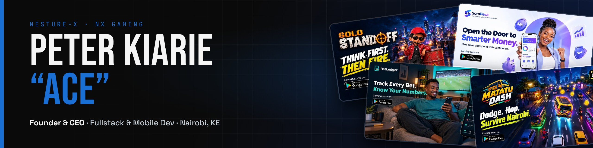
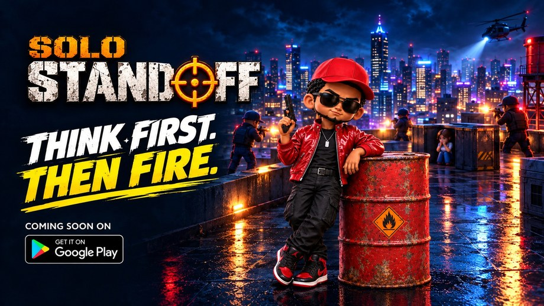
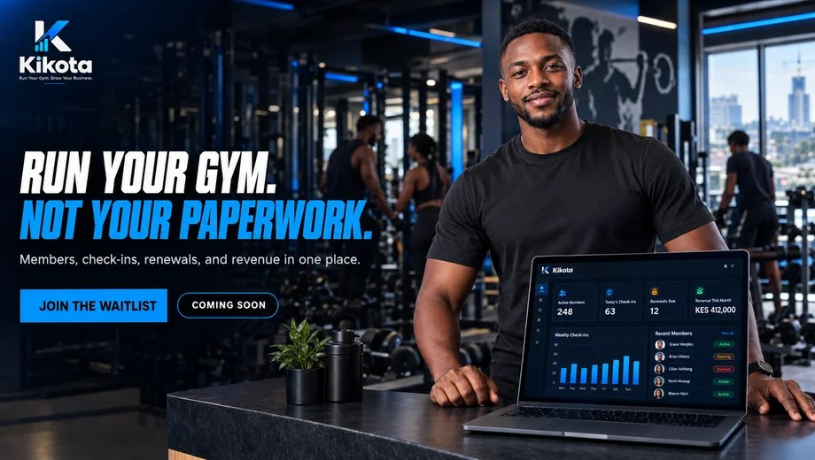

<p align="center">
  <a href="https://nesturex.com">
    
  </a>
</p>

<table>
<tr>
<td width="60%" valign="top">

I run **[Nesture-X](https://nesturex.com)**, a Nairobi creative tech studio, and I'm the one writing the code. Tech lead and creative director on every build, so design and code come from the same head.

Kenya-first. M-Pesa-native. Built to actually be used.


</td>
<td width="40%" valign="top">

**⚡ Right now**

- 🟢 **Bet Ledger** is live on Play Store
- 🎮 Launching **NX Gaming** with Solo Standoff
- 🚐 Building **Matatu Dash**
- 💰 Finishing the **SoraPesa** frontend

</td>
</tr>
</table>

## 🚀 Shipped & Shipping

<a href="https://nesturex.com/betledger"></a>

### 📊 [Bet Ledger](https://nesturex.com/betledger) `live on Play Store`
Bet tracking for Kenyan sports bettors. Log your bets, see your real numbers, and get honest insights on what's working and what isn't.

`React Native` `Kotlin` `Expo` `Firebase` `Google Sign-In`

[](https://play.google.com/store/apps/details?id=com.nesture.betledger)

<br />

<table>
<tr>
<td width="50%" valign="top">
<a href="https://nesturex.com/solo-standoff"></a>

### 🎮 [Solo Standoff](https://nesturex.com/solo-standoff)
`in development`

NX Gaming's first title. Tap a character to fire, and the order of your shots is the puzzle. 70 levels, a props tray and weekend Daily Challenges.

`React Native` `Supabase` `AdMob`
</td>
<td width="50%" valign="top">
<a href="https://nesturex.com/matatu-dash"></a>

### 🚐 [Matatu Dash](https://nesturex.com/matatu-dash)
`in development`

A Crossy Road style hopper on Nairobi streets. Dodge matatus, bodabodas and hawkers, with real street-recorded audio and leaderboards.

`React Native` `Skia` `Reanimated` `Node.js`
</td>
</tr>
<tr>
<td width="50%" valign="top">
<a href="https://nesturex.com/sorapesa"></a>

### 💰 [SoraPesa](https://nesturex.com/sorapesa)
`in development`

A Kenya-first money companion for young earners. Import your M-Pesa statement, get every transaction categorised, and see where your salary went.

`Expo` `TypeScript` `Supabase` `PostgreSQL`
</td>
<td width="50%" valign="top">
<a href="https://nesturex.com/kikota"></a>

### 🏋️ [Kikota](https://nesturex.com/kikota)
`MVP complete`

The operating system for African gyms. M-Pesa STK Push, QR check-ins, a live owner dashboard and full subscription lifecycle.

`React` `Node.js` `MongoDB` `Socket.io` `Daraja`
</td>
</tr>
</table>

> Most repos are private. Click any project for the full story on nesturex.com.

## 👨‍💻 About

```ts
const ace = {
  role:      "Founder & CEO @ Nesture-X",
  wears:     ["tech lead", "creative director"],
  launching: "NX Gaming",
  offHours:  ["guitar", "drums", "keys"], // 🎵 hear a track below
  openTo:    "founders, devs & creators",
};
```

🎵 [Hear one of my tracks](https://www.youtube.com/watch?v=vWH9IivGbxM)

## 💻 Stack

<p align="left">
  
</p>

<details>
<summary><b>📊 GitHub stats & streak</b></summary>
<br />
<p align="center">
  
  
</p>
<p align="center">
  
</p>
</details>

## 🐍 Activity

<picture>
  <source media="(prefers-color-scheme: dark)" srcset="https://raw.githubusercontent.com/Ace-Kiarie-Dev/Ace-Kiarie-Dev/output/snake-dark.svg" />
  <source media="(prefers-color-scheme: light)" srcset="https://raw.githubusercontent.com/Ace-Kiarie-Dev/Ace-Kiarie-Dev/output/snake-light.svg" />
  
</picture>

## 🌐 Connect

**Me**

[](mailto:peterkiarie@nesturex.com)
[](https://www.linkedin.com/in/peter-kiarie/)
[](https://x.com/Ace_Kiarie)
[](https://www.instagram.com/ace_kiarie/)
[](https://www.behance.net/peterkiarie3)

**Nesture-X**

[](https://nesturex.com)
[](https://www.instagram.com/nesture_x/)
[](https://www.tiktok.com/@nesture.x)
[](https://x.com/Nesturex)
[](https://www.youtube.com/@nesture-x)

<p align="center">
  <br />
  
  <br />
  <sub>Built in Nairobi 🇰🇪 · Nesture-X</sub>
</p>
